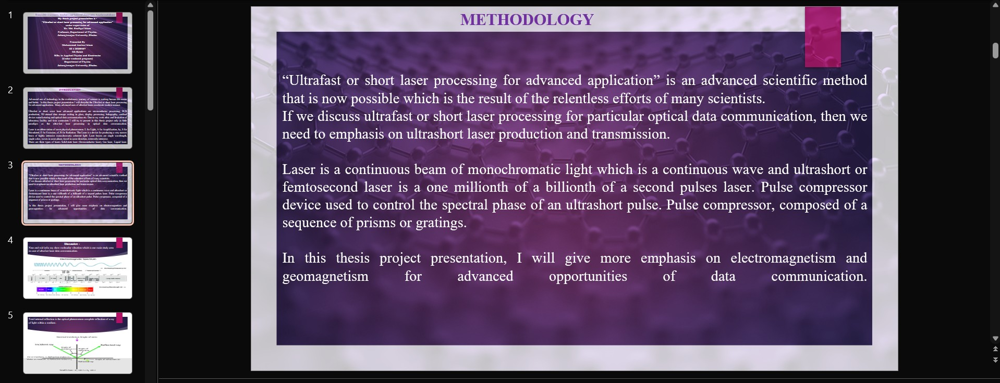
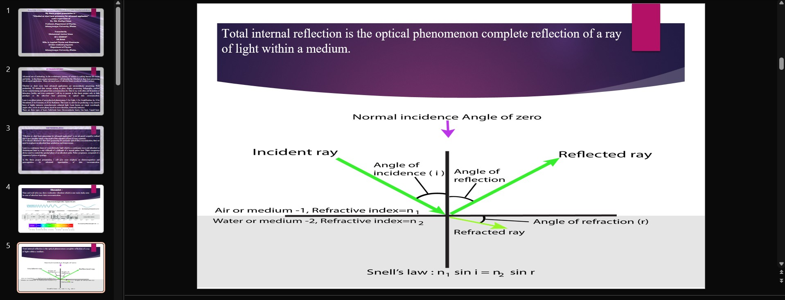
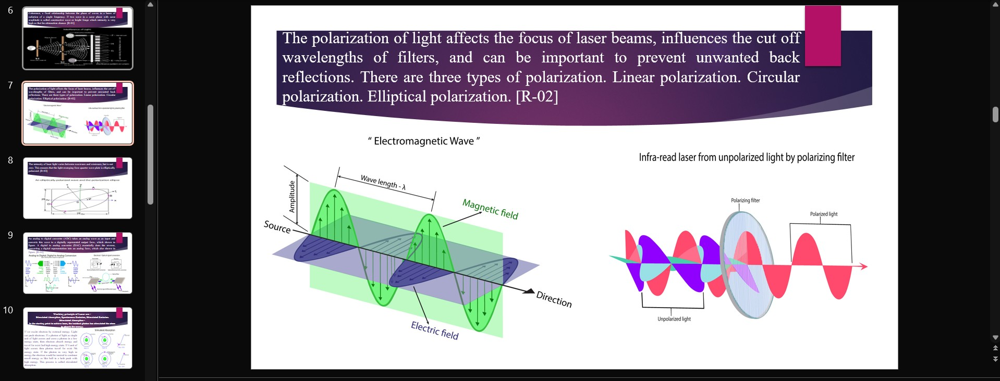
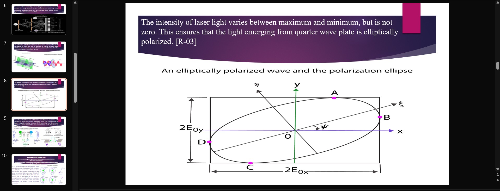
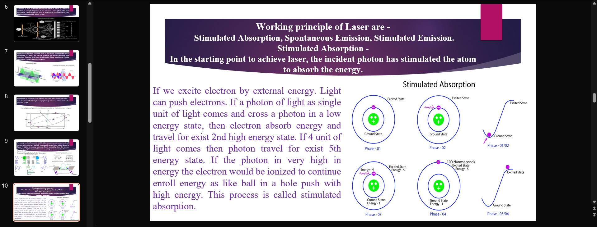
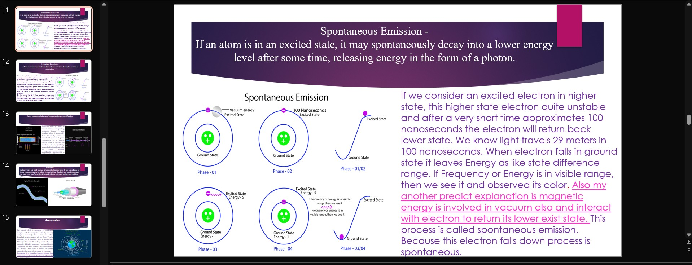
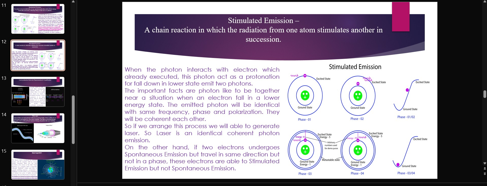
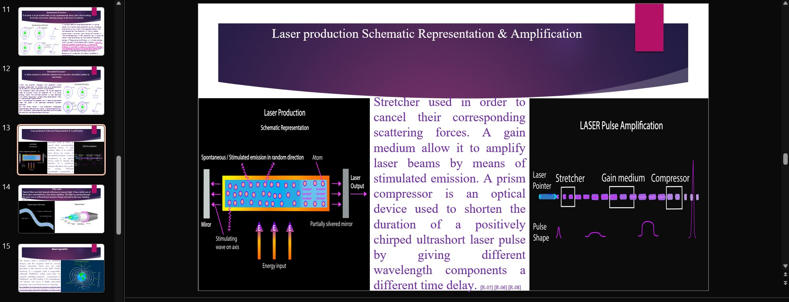
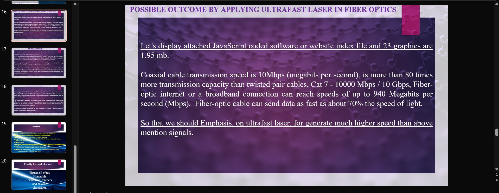
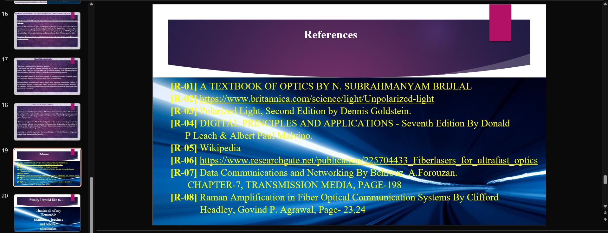

  
**Live URL:**  https://aminbiography.github.io/Ultrafast-or-short-laser-processing-for-advanced-application/
    
---                                           
    
## **Data Communication Media & Protocols for Cyber Threat Defense** 

## Table of Contents
 - Live Project References URL
 - Preview Images
 - Copyright Notice

> **References - Google Slides Presentation (February 2022):**  
> Islam, M. A. (2020-2026). *Data Transmission Medium and Methods for Cyber Threat Defense* [Google Slides](https://docs.google.com/presentation/d/1s9r5FhZTcpHJZlg9hu3Xsdx208VXPMyY/edit?usp=drive_link)

---

---

## Academic Research & Thesis Domain

**Thesis Title:** Ultrafast or Short Laser Processing for Advanced Applications

**Academic Institution:** Jahangirnagar University (JU), Bangladesh

**Department:** Department of Physics

**Academic Program:** MSc in Applied Physics and Electronics (Weekend Program)

**Research Supervisor:** Professor Dr. Md. Shafiqul Islam

### Main Thesis Domain

This thesis explores the application of ultrafast (ultrashort-pulse) laser technology in advanced data communication, with particular emphasis on application-layer data processing, optical signal transmission, signal strength, and communication speed.

The research focuses on the relationship between data processing, optical signal characteristics, electromagnetic principles, and fiber-optic communication technologies. It examines how data is processed and transmitted through communication systems, how optical signal strength and transmission characteristics influence communication performance, and how ultrafast laser technology may contribute to advanced optical processing and communication applications.

### Key Research Areas

- Application-layer data processing and communication
- Data signal processing, encoding, and transmission
- Optical signal strength, intensity, and power
- Data transmission speed and communication performance
- Signal quality, attenuation, and transmission efficiency
- Ultrafast and ultrashort-pulse laser technology
- Laser generation, amplification, and pulse compression
- Electromagnetic principles and optical phenomena
- Laser coherence, polarization, and intensity
- Optical fiber communication and total internal reflection
- Optical data transmission and communication systems
- Signal propagation, bandwidth, and transmission efficiency
- Geomagnetism and magnetic-field considerations in optical communication
- Advanced applications of laser processing

### Research Focus

The principal research focus is the processing and transmission of digital data through advanced optical communication systems. Particular attention is given to application-layer data processing, optical signal strength, transmission speed, and the factors that influence data communication performance.

The research also explores the potential role of ultrafast laser technology in improving optical processing and supporting high-speed fiber-optic communication. It considers the relationship between data handling, optical signal characteristics, transmission efficiency, and the performance of modern communication systems.

### Academic Context

This repository documents an independently maintained academic thesis project associated with the Department of Physics, Jahangirnagar University, Bangladesh. It is not an official university repository.

---

### **Copyright**

**© 2020–2026 Mohammad Aminul Islam. All Rights Reserved.**

This presentation titled **“Data Transmission Medium and Methods for Cyber Threat Defense”**, with reference to **“Ultrafast or Short Laser Processing for Advanced Application”**, and all associated content-including text, figures, explanations, diagrams, design elements, and research summaries-are the intellectual property of **Mohammad Aminul Islam**.

No part of this material may be:

* copied,
* reproduced,
* distributed,
* displayed,
* transmitted, or
* stored in any retrieval system

in any form or by any means (electronic, mechanical, photocopying, recording, or otherwise) **without prior written permission from the author**.

Unauthorized use of this presentation or any portion thereof is strictly prohibited.

---

#UltrafastLaserProcessing #SignalProcessing #ApplicationLayer #ApplicationLayerSecurity #ShortPulseLaser #UltrashortPulseLaser #LaserTechnology #LaserApplications #Photonics #AppliedPhysics #OpticalEngineering #MaterialsScience #OpticalCommunication #OpticalFiber #FiberOptics #OpticalDataCommunication #DigitalSignalProcessing #SignalStrength #SignalAnalysis #SignalDetection #SignalTransmission #SignalReception #SignalQuality #SignalIntegrity #SignalAttenuation #SignalAmplification #SignalModulation #SignalDemodulation #OpticalSignalProcessing #CommunicationSystems #DataTransmission #Telecommunication #WirelessCommunication #NetworkCommunication  #ApplicationLayerProtocols #NetworkLayer #TransportLayer #SessionLayer #PresentationLayer #OSIModel #TCPIP #NetworkProtocols #NetworkSecurity #CyberSecurity #InformationSecurity #DataSecurity #ApplicationSecurity #SecureCommunication #NetworkProtection #DataEncryption #Cryptography #Authentication #AccessControl #SecureDataTransmission #ThreatDetection #IntrusionDetection #CommunicationSecurity #InternetSecurity #DigitalCommunication #CommunicationEngineering #ElectronicsAndCommunication #LaserResearch #ScientificResearch #ResearchProject #ThesisResearch #JahangirnagarUniversity #MohammadAminulIslam

---
