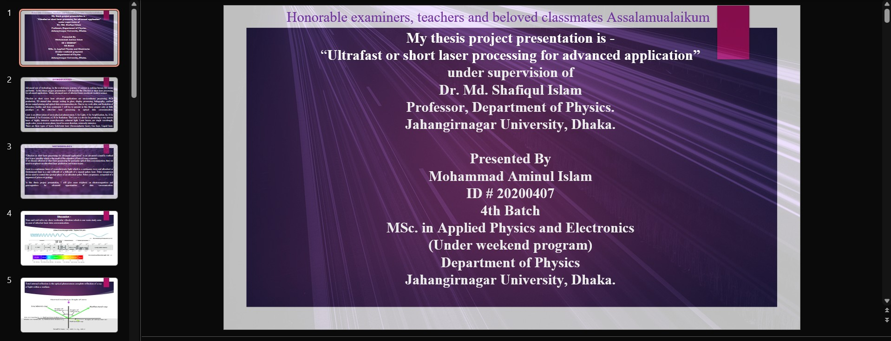
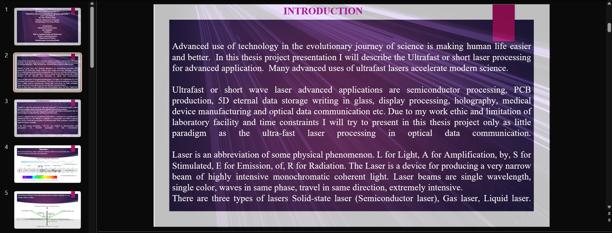
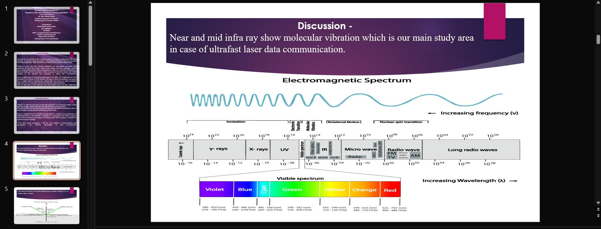
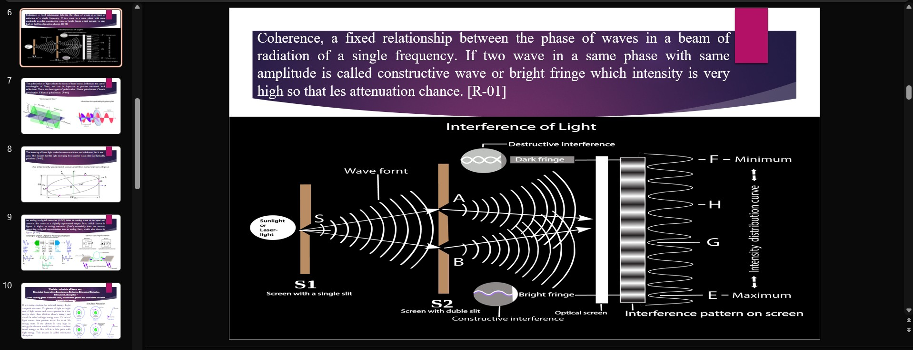
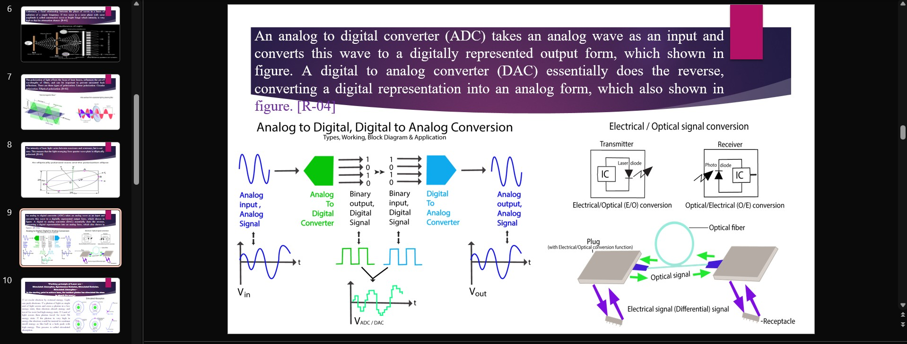
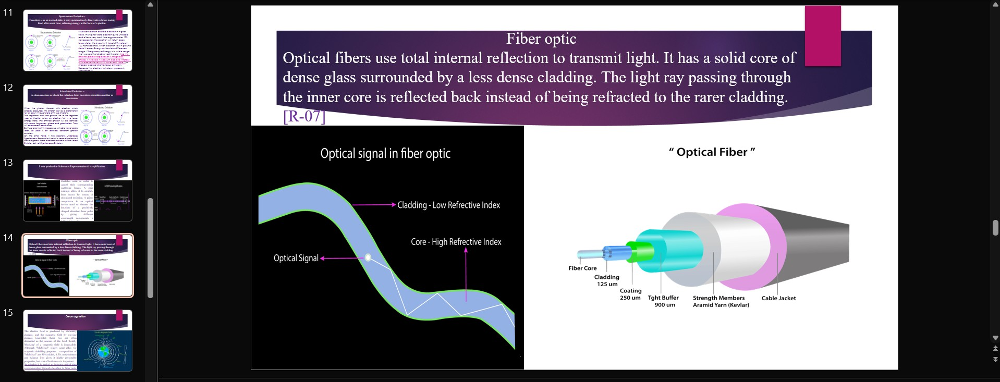
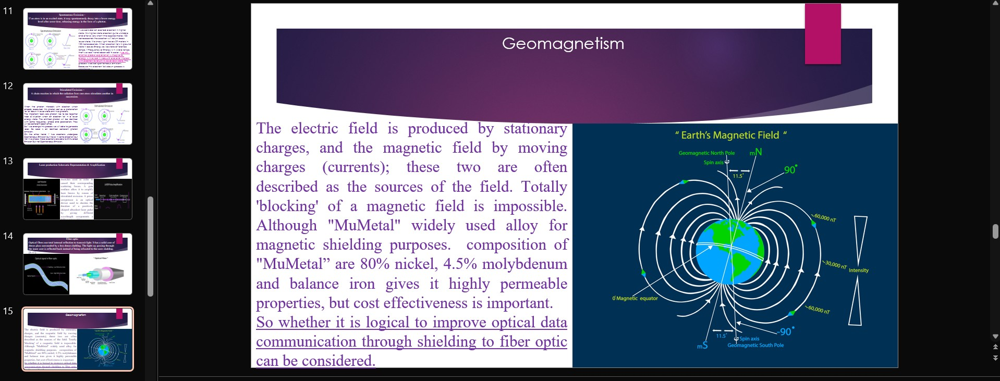
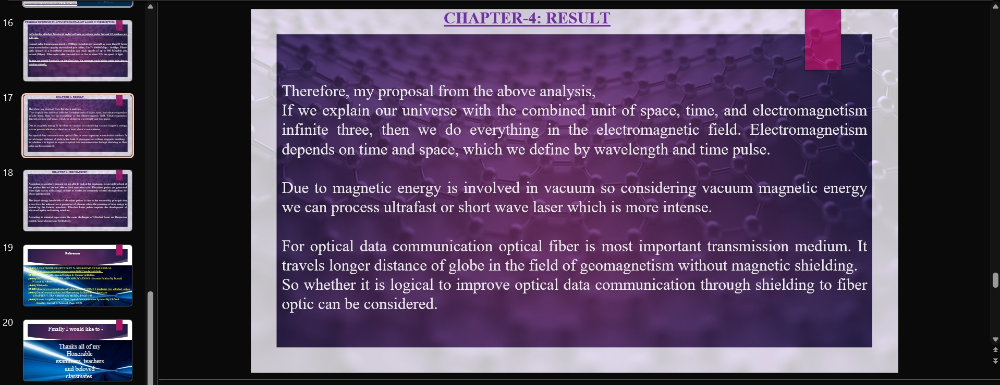
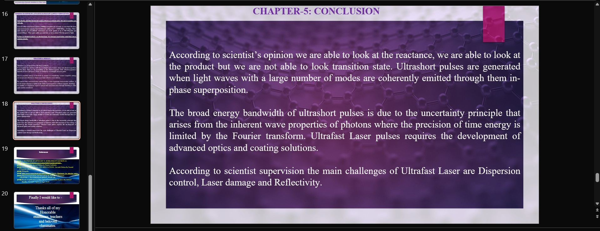
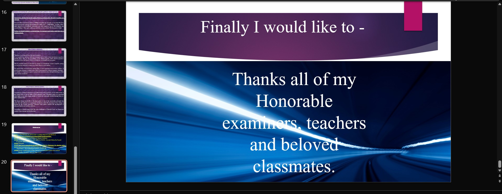

  
**Live URL:**  https://aminbiography.github.io/Ultrafast-or-short-laser-processing-for-advanced-application/
    
---                                           
    
## **Data Communication Media & Protocols for Cyber Threat Defense** 

## Table of Contents
 - Live Project References URL
 - Preview Images
 - Copyright Notice

> **References - Google Slides Presentation (February 2022):**  
> Islam, M. A. (2020-2026). *Data Transmission Medium and Methods for Cyber Threat Defense* [Google Slides](https://docs.google.com/presentation/d/1s9r5FhZTcpHJZlg9hu3Xsdx208VXPMyY/edit?usp=drive_link)

---

---

## Academic Research & Thesis Domain

**Thesis Title:** Ultrafast or Short Laser Processing for Advanced Applications

**Academic Institution:** Jahangirnagar University (JU), Bangladesh

**Department:** Department of Physics

**Academic Program:** MSc in Applied Physics and Electronics (Weekend Program)

**Research Supervisor:** Professor Dr. Md. Shafiqul Islam

### Main Thesis Domain

This thesis explores the scientific principles and advanced applications of ultrafast (ultrashort-pulse) laser processing, with particular emphasis on optical data communication and fiber-optic transmission.

The research focuses on the relationship between ultrashort laser pulses, electromagnetic principles, optical phenomena, and advanced communication technologies. It examines the potential of ultrafast laser technology to support improvements in optical signal transmission and explores relevant concepts in laser physics and fiber-optic communication.

### Key Research Areas

- Ultrafast and ultrashort-pulse laser technology
- Laser generation, amplification, and pulse compression
- Electromagnetic principles and optical phenomena
- Laser coherence, polarization, and intensity
- Optical fiber communication and total internal reflection
- Optical data transmission and communication systems
- Geomagnetism and magnetic-field considerations in optical communication
- Advanced applications of laser processing

### Research Focus

The principal area of investigation is the potential application of ultrafast laser technology in optical data communication, particularly through fiber-optic transmission systems.

**Academic Context:** This repository documents an independently maintained academic thesis project associated with the Department of Physics, Jahangirnagar University. It is not an official university repository.

---

### **Copyright**

**© 2020–2026 Mohammad Aminul Islam. All Rights Reserved.**

This presentation titled **“Data Transmission Medium and Methods for Cyber Threat Defense”**, with reference to **“Ultrafast or Short Laser Processing for Advanced Application”**, and all associated content-including text, figures, explanations, diagrams, design elements, and research summaries-are the intellectual property of **Mohammad Aminul Islam**.

No part of this material may be:

* copied,
* reproduced,
* distributed,
* displayed,
* transmitted, or
* stored in any retrieval system

in any form or by any means (electronic, mechanical, photocopying, recording, or otherwise) **without prior written permission from the author**.

Unauthorized use of this presentation or any portion thereof is strictly prohibited.

---
